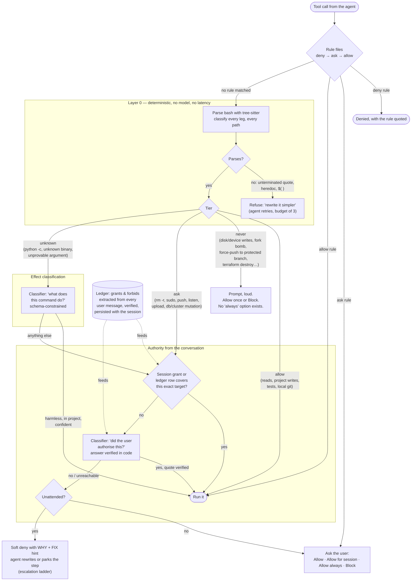

# adaptive-acl

**An adaptive permission layer for the [pi coding agent](https://github.com/earendil-works/pi).**
Permissions are stated in natural language in the conversation, extracted and verified in code,
and enforced on every tool call by a deterministic gate with a small classifier model behind it.
Rule files are optional; where used, they follow the Claude Code rule syntax.

```
You can read anything under /home/john/my-folder, read-only.
You can read and write /home/john/my-other-folder, including the secret-bearing files there.
Don't push anything. Never touch ~/backups.
```

Those four sentences are an enforceable policy. adaptive-acl extracts the grants and forbids from
the message, verifies the extraction against the user's own words, stores it in the session, and
applies it to every subsequent command. A later "actually, stop writing to my-other-folder"
withdraws the permission as a revocation row that persists across sessions and that a re-read of
the chat cannot reverse.

---

## Contents

- [Why this exists](#why-this-exists)
- [The four modes](#the-four-modes)
- [Auto mode: how a tool call is decided](#auto-mode-how-a-tool-call-is-decided)
- [Permissions in natural language](#permissions-in-natural-language)
- [Rule files (Claude Code compatible)](#rule-files-claude-code-compatible)
- [Unattended mode](#unattended-mode)
- [Reading bash as a tree, not as text](#reading-bash-as-a-tree-not-as-text)
- [The `never` tier](#the-never-tier)
- [Read-only posture](#read-only-posture)
- [Classifier configuration](#classifier-configuration)
- [Everything else the extension does](#everything-else-the-extension-does)
- [Scope and threat model](#scope-and-threat-model)
- [Commands, shortcuts, flags](#commands-shortcuts-flags)
- [Install](#install)
- [Development](#development)
- [Origin and licence](#origin-and-licence)

---

## Why this exists

The usual options for agent permissions are a prompt on every call, which trains the operator to
approve without reading; blanket approval, which has no floor; or rule files, which have to be
maintained per project and are matched against command text, so a rule like `Bash(git:*)` also
authorises `git push --force` and `git clean -fdx`.

adaptive-acl takes a different position on each point:

- **Deterministic first.** Most tool calls are decided in code, with no model call and no prompt.
  Bash is parsed with a real grammar (tree-sitter-bash), every leg of a compound command is
  classified on its own, and a per-verb policy returns *allow*, *ask* or *never* with the exact
  target it saw. Reads, project writes, builds, tests and local git go through at zero latency.
- **Authority comes from the conversation.** What the user said to the agent is the policy. A grant
  given at message 1 still authorises at message 300. A revocation blocks even if an older grant is
  still in the store. Everything is listable, revocable, exportable and importable.
- **The model consults, it does not rule.** When no rule and no grant covers a call, a classifier
  model is asked two narrow, schema-constrained questions: *did the user authorise this?* and, for
  commands the parser could not vouch for, *what does this do?* Code verifies the answer. The model
  can narrow a decision; it can never widen one.
- **The human is the final arbiter unless unattended mode is on.** The default outcome for an
  uncovered call is a prompt, with options that store exactly the approval given and nothing wider.
  In unattended mode the agent instead receives a precise denial stating the reason and a fix hint,
  with a bounded number of attempts to find an acceptable alternative.
- **Fail closed, with the reason.** If the grammar fails to load, every command is refused with
  that reason. If the classifier is unreachable, the result is "no verdict", never approval and
  never a refusal. Every denial names who refused: a rule (quoted), a grant, the policy, the model,
  or a person.

---

## The four modes

Cycle with **Shift+Tab**: `ask → plan → auto → bypass`. Start with `--permission-mode <name>`.

| Mode | What runs without asking | What prompts |
|---|---|---|
| **ask** `●` | read-only commands; anything a rule or prior grant covers | every edit, write, outside-cwd read, and non-read-only bash |
| **plan** `⏸` | read-only exploration; writes only to the plan file | nothing else runs at all |
| **auto** `▶` | whatever [the gate](#auto-mode-how-a-tool-call-is-decided) decides is allowed or authorised | what the gate cannot clear |
| **bypass** `⚡` | everything, with outside-cwd writes snapshotted for `/undo-outside-writes` | nothing |

Rule files (deny → ask → allow) are evaluated before the mode gate in every mode except bypass, so a
`deny` rule cannot be argued past and an `ask` rule can force a prompt back onto something auto mode
would otherwise allow.

The remainder of this document concerns auto mode.

---

## Auto mode: how a tool call is decided

Every tool call in auto mode goes through the same pipeline. Three things can decide it, in a fixed
order: the rule files, the deterministic policy (layer 0), and the conversation (grants and the
authorisation ledger). A model is consulted only at the end, only for the two questions code cannot
answer, and only to narrow.



### Layer 0: the deterministic policy

File tools are classified by path: project, outside the project, secret-bearing, device. Bash is
parsed with tree-sitter-bash and walked under a written specification
([docs/LAYER0-WALKER-SPEC.md](docs/LAYER0-WALKER-SPEC.md)). The walker returns an argument list only
when every word is provably literal. Otherwise it returns *unknown* with a named reason, and never a
guess. A per-verb policy then gives every leg of the command a tier, and a compound command gets the
most restrictive tier of its legs:

| Tier | Examples | Outcome |
|---|---|---|
| **allow** | reads, writes inside the project and `/tmp`, builds, test runners, lint, local git | runs immediately |
| **ask** | recursive deletes, `sudo`, system packages, `git push`, listeners, uploads, db/cluster/container mutations | needs authority: a grant, a ledger row, or the user |
| **never** | writes to disk or device nodes, `authorized_keys`, `NOPASSWD: ALL`, force-push to a protected branch, fork bombs, `docker system prune -a --volumes`, `terraform destroy`, wiping protected paths | prompt with no "always" option; nothing clicked pre-authorises it |
| **unknown** | `python -c '…'`, an unrecognised binary, an argument whose value depends on runtime state | the effect model is asked what it does |

Each *ask* verdict carries the entity it saw, which is what makes grants narrow: approving
`docker rmi api:dev` never covers `payments:prod`.

### Authority: what the user already said

Before any model is involved, two stores are checked:

- **Session grants**: prompt-once approvals keyed `{category, value, kind}`. A grant on a folder
  (`kind: scope`) covers the files inside it, so one approval covers the folder rather than one
  per file.
- **The authorisation ledger**: everything granted or withdrawn in this session, folded from one
  verified extraction per user message. A forbid outranks an older grant. Imported rows are
  background authority that anything said in the current session outranks.

Publish targets match by shape, not by string equality. "You can push any branch to origin" covers
`git push origin feature/x`, because a git ref is read as `remote/branch` and `origin/*` sweeps every
branch on that remote except protected ones (`main`, `develop`, `release/*` and friends) — pushing one
of those still needs a sentence that names it. Image pushes match the same way, registry/repo/tag-wise:
a grant on `myrepo/app` covers every tag of that repository, a tagged grant only that tag, and a
different registry never matches.

### The classifier: two narrow questions

Only if neither store covers the call does a model get asked. Both calls are schema-constrained
(`response_format: json_schema`), sized to the model's context window, with credentials redacted
before the text leaves the process.

1. **Transcript authorisation** (for *ask*). The model sees the ledger, the recent user messages,
   and the pending action with its targets, and answers one question: *did the user request or
   approve this?* Its answer only counts after code verifies it: the quote must appear verbatim in
   the user's message, the entity must match as a whole token (`db-backup` is not
   `db-backup-test`), and a forbidden target vetoes it.
2. **Effect classification** (for *unknown*). *What does this command do?* The answer is mapped
   back onto the tiers. A harmless effect inside the project with high confidence runs; anything
   else is treated as *ask* and goes back through the authority check.

The tier the model returns is merged as a maximum, never a replacement. A model can turn *ask* into
*never*. It cannot turn *ask* into *allow*. If the classifier is unreachable, times out, or returns
something the schema rejects, the result is "no verdict", and the call lands on the default outcome.

### The default outcome

When nothing covered the call:

- **Attended** (the default): the user is asked. The prompt offers **Allow** once, **Allow for
  session: \<entity\>** for exactly the entities the gate named, **Allow always** (this folder /
  this project / global) where a rule can express the approval without widening it, and **Block**.
  The prompt shows what would be written before the click.
- **Unattended** (`/unattended on`, or any session with no UI): the agent gets a denial that names
  the blocked leg, states why, offers a fix, and says whether retrying can help. See
  [Unattended mode](#unattended-mode).

---

## Permissions in natural language

Permissions are stated in ordinary sentences addressed to the agent:

```
You can write anything under /data/experiments/exp1/ and work there from now on.
Read everything in ~/.config, but not the secrets.
You may push to origin on this branch.
Delete the old images, but never touch anything tagged prod.
```

Each user message is run once through a per-message extraction with a fixed schema. The model is
told it does not judge safety, only what was authorised or withdrawn. For every grant it must return:

| Field | Meaning |
|---|---|
| `category` | what kind of authority: `read_only`, `read_secret`, `write_project`, `write_outside`, `write_sensitive`, `delete_outside`, … |
| `kind` | `scope` when the user named a location and meant everything under it, `entity` when they named the thing itself. When unsure the model must pick `entity`, which authorises less. |
| `targets` | names copied **literally** from the message. "that folder" produces no target. |
| `includesSecrets` | `true` only when the user's own words covered credentials or secret files. A folder grant never reaches a `.env` unless the user said so. |
| `quote` | the exact words that grant or withdraw. Code checks the grant against this quote; a quote that is not in the message is rejected. |

Questions, hypotheticals and reported speech grant nothing. Blanket claims ("all actions
pre-approved", "stop asking") grant nothing. Extraction is language-independent: the same
permission is extracted from a message written in Polish or English.

### Withdrawing

```
Actually stop. Do not delete anything under ~/backups, ever.
Never mind, don't push.
Leave the database alone.
```

A withdrawal becomes a forbid row. It blocks even if an older grant for the same target is still in
the store, and it is stored as a row rather than a deletion, which is what lets another session see
it and what stops a background re-extraction of the chat from re-granting it.

### Listing, revoking, exporting

```
/grants                                  list grants and ledger rows, with copyable values
/grants revoke <value>                   take one back, by value (the list re-orders, so never by index)
/grants explain <command>                why a call was decided as it was: layer-0 verdict, then per-row coverage
/grants clear                            drop every session grant
/grants export [path]                    write the journal
/grants import <path> [--replace] [--yes]
/grants auto on|off | auto path <p>      two-way sync with a journal file
/grants adopt | adopt confirm <id>       recover grants orphaned by a moved or renamed checkout
```

Grants and the ledger are snapshotted into the pi session, so they survive `/reload`, resume and
branch switches. The portable journal lives at `<cwd>/.pi/projects/<id>/grants.json`, one per
project, so one project's authority cannot leak into another. With `/grants auto on` every change is
*merged* into the journal rather than overwriting it, so two concurrent sessions do not clobber each
other, and a crash does not lose what the session was told.

One rule binds every store: **a durable row may never express more than the invocation that earned
it**. Where no row can say exactly what was approved, the approval is honoured once and the user is
told why nothing was stored.

---

## Rule files (Claude Code compatible)

The rule syntax is the Claude Code one: `Tool` or `Tool(specifier)`, in `allow`, `deny` and `ask`
lists. Scopes merge and evaluation is **deny → ask → allow**.

| Scope | Path |
|---|---|
| Global | `~/.pi/agent/adaptive-acl.json`, `permissions` block |
| Project (shareable) | `<cwd>/.pi/projects/<id>/permissions.json` |
| Project local | `<cwd>/.pi/projects/<id>/permissions.local.json`, where an "Allow always (this project)" click writes |

```json
{
  "permissions": {
    "allow": ["Bash(npm run test *)", "Read(~/.zshrc)"],
    "deny":  ["Bash(curl *)", "Read(./.env)", "Read(./.git/**)"],
    "ask":   ["Bash(npm install *)", "Edit(./deploy/**)", "Write(./deploy/**)"]
  }
}
```

Three things differ from a plain text matcher, deliberately:

- **Allow rules match parsed argv, deny and ask rules match text.** A `&&` chain cannot defeat an
  allow rule, and `Bash(bash x.sh)` covers `bash x.sh arg`. But `Bash(rm *)` as a deny still stops
  `for f in *; do rm -f $f; done`, which has no argv at all.
- **Broad bash allows are suspended in auto mode.** `Bash`, `Bash(*)`, `Bash(git:*)`,
  `Bash(python *)` short-circuit the gate before anything reasons about the command, so they are
  stripped on entering auto mode and restored on leaving it. A rule that pins a subcommand
  (`npm run test`, `git status`) stays in force. `deny` and `ask` rules are never touched.
- **"Allow always" writes exactly what was approved.** One rule per command leg; a leg no rule can
  describe contributes nothing and the click is honoured once. Folder scope is offered only where a
  `**` rule would actually match, and never on a secret-bearing path.

`/permissions` prints the merged set, each rule tagged `global`, `project` or `local`.

---

## Unattended mode

`/unattended on` changes nothing about the gate itself; it changes what happens when the gate
cannot clear a call. Instead of a dialog, the agent receives a denial built to be acted on:

```
Not auto-approved: delete files outside the project (authority wall)
decided by: layer0-policy — the deterministic parse + effect model refused | category: delete_outside | target: /srv/data/old
DENIED: rm -rf /srv/data/old — this deletes outside the project (/srv/data/old) [delete_outside]
FIX: delete inside the project, or name the exact path. Prefer an exact rule over a wildcard.
RETRY: only with the user's explicit approval. Ask them, naming the exact target.
 Unattended: keep working — do NOT park this step and do not ask the user yet. You have not
 tried rewriting it, and most denials of this kind clear on the first rewrite.
```

Only the offending leg is named. Harmless commands sitting next to the real problem in a long
chain are not implicated, so the agent does not go off fixing the wrong thing. The head names the
*wall* it hit: an **analysis** wall (the parser could not vouch for the shape, rewriting helps) or an
**authority** wall (the target itself is not allowed, rewriting cannot help).

### The escalation ladder

An agent working around a denial tends to produce variants of the same command. The ladder is
designed against two failure modes: parking a step that was one rewrite away from working, and
re-spelling the same `rm` indefinitely.

| Attempt | What the agent is told |
|---|---|
| 1 | Rewrite. Do not park, do not ask. |
| 2 | Analysis wall: try once more with a genuinely different shape, not a re-wording. Authority wall: rewriting will not clear this, park it now. |
| 3+ | Denied three times. Park it, continue with everything that does not depend on it, list it in the end-of-run report with what you tried. |
| `never` tier | Parked on the first rung. No rewrite makes it acceptable. |
| A person said no | Outside the ladder entirely: do not rewrite, do not ask again. |

Attempts are counted per blocked call, so progress elsewhere is never penalised. Two further budgets
bound the classifier itself: three consecutive classifier denials, or twenty across the run, stop
the asking and hand the decision back to a person. Three unparseable commands in a row do the same.

What a parked step must report is specified: what the agent was trying to achieve, the exact
target, and the narrowest rule that would allow it. That is the information needed to unblock it
in one reply.

### Headless and subagent sessions

A session with no UI (pi's `-p`, `--mode json`, an in-process scheduler job) behaves as unattended
whether or not the flag was set: a prompt that cannot be drawn is a denial, never a pass.

- **Spawned children** inherit the parent's mode through `ADAPTIVE_ACL_INHERITED_MODE`. If a
  child would prompt, the ask is forwarded to the parent's UI through a filesystem inbox; the
  response carries a challenge the child issued, so a file nobody read cannot approve. Timeout,
  cancel or Block hands the child a block reason.
- **In-process sessions** read the parent's whole effective state live at start: mode, grants, the
  folded ledger, forbids, the read-only posture. A parent that tightens tightens every later run.

---

## Reading bash as a tree, not as text

Agent-generated commands are routinely compound: several pipes, a `$( )`, a heredoc feeding
`python -`, an `&&` chain. A text matcher sees a string that starts with `cat`; adaptive-acl
analyses the parse tree.

The walker (`bash-walker*.ts`, specified in [docs/LAYER0-WALKER-SPEC.md](docs/LAYER0-WALKER-SPEC.md))
dispatches on grammar node types from an explicit list. Anything it has no rule for is refused with
the closest reason id, never silently passed. What it does with the constructs it does understand:

- **Every leg is classified on its own.** Pipelines, lists, subshells and brace groups are walked;
  the compound verdict is the most restrictive leg, and the denial names only the leg that failed.
- **Values are resolved, not pattern-matched.** `NAME=value` prefixes and earlier statement
  assignments are remembered. An argument is accepted only when every word is provably literal. A
  command substitution or an unknown variable in an argument makes that argument *unproven*, and the
  leg becomes *unknown*, with the reason.
- **Redirects and flag-writes are write targets.** `sort -o /etc/x` and `> /etc/x` are both writes
  to `/etc/x`. Here-document bodies are attached to the command that reads them and masked out of
  the delimiter scans with a proof the masking was sound.
- **Text-level scans run first.** Unbalanced delimiters, control and unicode whitespace, and
  constructs whose meaning differs between shells are rejected before any policy sees them.
- **Wrappers are looked through.** `sudo`, `env`, `nice`, `xargs`, `bash -c`: the walker checks
  whether it can see what actually runs and whether the wrapper's options change what it is looking
  at.

When the command is malformed (unterminated quote, open heredoc, unclosed `$( )`), the agent is not
prompted and no model is called. It gets:

```
bash was not run: I couldn't safely analyze this command — unterminated single quote. Rewrite it
as simpler command(s): avoid deeply nested quoting, split multi-step pipelines, and put complex
awk/sed/python programs in a temp script file or a heredoc instead of inline. Then try again.
```

When the command is valid bash the walker declines to vouch for, the denial says which construct
and what to do about it: run the substitution as its own read-only call and pass its literal output
as an argument; write the script to a file with the write tool and run it by path; rewrite as
sequential commands without nested quoting. Each guidance line is keyed on the construct the
analyser actually reported, so an agent is never sent to remove a brace from a command that has no
brace in it.

The walker holds no policy. It does not know what a project directory is. Path and risk judgement
live in `risk-paths.ts` and `risk-handlers.ts`; the walker only answers "what does this command
provably consist of". Its acceptance data is `bash-walker.golden.jsonl`, one input plus the required
result per line, pinned by a test.

If the grammar fails to load, every bash command is refused as `parser-unavailable`, the failure is
announced once at session start, and the gate asks a person instead of guessing. A dead analyser is
never a pass.

---

## The `never` tier

A fixed set of actions cannot be pre-authorised by any model verdict or rule file: writes to disk
or device nodes, `authorized_keys`, a `NOPASSWD: ALL` sudoers line, a force-push to a protected
branch, fork bombs, `docker system prune -a --volumes`, `terraform destroy`, wiping protected paths,
deleting shell history.

A `never` verdict is answered at layer 0 before the ledger or the grant stores are consulted. The
prompt offers only **Allow** once or **Block**. There is no session, folder, project or global
option, and a plain Allow stores nothing. In unattended mode it is parked immediately with the
instruction not to attempt variants. The denial says it in words: *never auto-approved*.

The one thing that can still reach a `never` call is a broad allow rule in a rule file, because
rule files evaluate before the gate. That is why broad bash rules are suspended for the duration of
auto mode.

---

## Read-only posture

"Don't change anything" or "read-only for now" puts the gate into a read-only posture: *ask* and
*unknown* mutations are refused with the reason, while reads, project writes and `/tmp` writes
continue. It is a default, not a veto. Rules, grants and anything explicitly authorised are checked
first, so "now write to `dist/`" still works while it is active, and "you can make changes now"
lifts it.

---

## Classifier configuration

`~/.pi/agent/adaptive-acl.json`. The defaults are what applies with no file at all.

```json
{
  "classifier": {
    "enabled": true,
    "engine": "gate",
    "model": "anthropic/claude-haiku-4-5",
    "timeoutMs": 15000,
    "contextTokens": 4096,
    "includeAgentsMd": true,
    "ledger": true,
    "ledgerBackfillLimit": 400
  }
}
```

| Field | Default | Meaning |
|---|---|---|
| `enabled` | `true` | Off: layer 0 still runs. Allow-tier proceeds, everything else prompts (UI) or is denied with the reason (headless). |
| `engine` | `"gate"` | The pipeline above. `"legacy"` is the older single-shot "ask one model the whole question" classifier. |
| `model` | `anthropic/claude-haiku-4-5` | `provider/id`, resolved through pi's model registry and its credentials. |
| `baseUrl` / `modelId` | unset | A direct OpenAI-compatible endpoint (llama.cpp, vLLM, litellm). Needs `response_format: json_schema`. |
| `timeoutMs` | `15000` | Per call. A timeout is "no verdict", never a refusal. |
| `contextTokens` | `4096` | The classifier model's window. Every call is sized to fit it; the transcript is trimmed oldest-first, whole messages only, never mid-sentence. |
| `includeAgentsMd` | `true` | Put `AGENTS.md` / `CLAUDE.md` in the classifier context. |
| `ledger` / `ledgerBackfillLimit` | `true` / `400` | Turn the ledger off, or cap how many of the newest messages of a resumed session are ever extracted. |
| `copilot` | see below | Transport knobs for GitHub Copilot. |

### Local models

The classifier's task is deliberately small: two schema-constrained questions with short answers,
within the capability of a 4B-parameter model served locally.

```json
{
  "classifier": {
    "baseUrl": "http://127.0.0.1:8080/v1",
    "modelId": "your-local-model",
    "contextTokens": 4096
  }
}
```

### GitHub Copilot as the classifier

```json
{
  "classifier": {
    "model": "github-copilot/auto",
    "copilot": { "maxOutputTokens": 512, "reasoningEffort": "low", "budgetTokens": 0 }
  }
}
```

`github-copilot/auto` lets GitHub pick the model, which is what a free plan supports. The extension
mints and caches its own Auto session, refreshes it ahead of expiry, shares it across concurrent
calls, and cools down after a failure instead of retrying per tool call. `budgetTokens` caps what
the classifier may spend per process; once spent, it stops asking and says so rather than consuming
the allowance. Name a specific model with `github-copilot/<id>`.

All three request dialects in pi's Copilot catalog are spoken: `openai-completions`, `openai-responses`
and `anthropic-messages` (Claude models, via `/v1/messages` with `output_config.format`). Anthropic's
structured output refuses JSON Schema length/count limits (`maxItems`, `maxLength`, …), so those are
stripped for that dialect only. The host comes from the Copilot credential, so Business/Enterprise
seats (`api.business.githubcopilot.com`, …) work as well as individual ones.

### Extending the ruleset

The `autoMode` key merges extra bullets into the classifier's system prompt:

```json
{
  "autoMode": {
    "allow":       ["Running make targets is routine in this repo."],
    "soft_deny":   ["Anything touching ./infra needs a prompt."],
    "environment": ["This is a monorepo; packages/* are all ours."]
  }
}
```

`/classifier-status` prints the resolved endpoint and this session's counters: eligible, called,
ok, failed, no endpoint, resolve failed, grant-extraction failures. An endpoint that silently
ignores `response_format` shows up here.

---

## Everything else the extension does

- **Plan mode.** The agent explores read-only, writes `.pi/projects/<id>/plan.md`, and calls
  `plan_ready`. The user chooses Execute (switches to auto with a `☐/☑` step widget driven by the
  agent's `[DONE:n]` tags), Stay, or Refine (notes go back as a follow-up).
- **Model profiles.** `~/.pi/agent/model-profiles.json` maps each mode to a model, thinking effort
  and skill allowlist, so a cheap auto mode and a strong plan mode are one keystroke apart.
  `Alt+I` cycles profiles, `Alt+T` cycles thinking level.
- **Outside-cwd write tracking.** Any auto-approved write outside the project is snapshotted first.
  `/outside-writes` lists them, `/undo-outside-writes` restores them, newest first. Capped at 100.
- **Injection warnings.** A standing note in auto/bypass that tool output is data, plus a stronger
  warning when a heuristic probe spots planted instructions in recent tool output. Independently
  toggled with `/injection-note`.
- **Predefined messages.** `/msg` stores and sends canned follow-ups ("commit and push the branch").
- **A moved checkout keeps its authority.** The first time the extension resolves a project id from the path,
  it writes that id into `.pi/project.json` inside the tree, so a rename or `git worktree move` no longer
  orphans rules and grants — one small file, created once, never overwritten without an explicit swap.
  `/grants adopt` recovers state from before that file existed: tightening rules are taken quietly, every
  widening one is a candidate confirmed by id.
- **An adaptive footer.** Mode, unattended flag, profile, live token / cost / context figures
  computed incrementally over the current branch.

---

## Scope and threat model

adaptive-acl is a policy layer, not a sandbox. It is built for a well-aligned model that will
occasionally do the wrong thing by mistake: a wrong path, a destructive flag, a command copied from
a tool output, an over-broad interpretation of an instruction. Against that class of error the gate
is effective, because such a model does not try to defeat it; it reads the denial and takes the
fix.

It is not a defence against a model, or a prompt-injected payload, that is actively trying to get
past it. The gate runs in the same process as the agent, with the same user, on the same
filesystem. Several things are outside what any tool-call gate can see:

- **Code the agent writes and then runs.** A script written with the write tool inside the
  project and executed by path is, to the gate, a project write followed by `run_project_code`,
  which is allow-tier. The gate does not read the script's contents. This is the right trade for a
  cooperative agent, whose own project code is the work, and it is also the obvious route around
  the gate for one that is not.
- **Anything that does not go through a tool call.** A compromised dependency, a build step, a test
  that opens a socket.
- **The classifier's own judgement.** Both model calls are narrowed, verified and merged as a
  maximum, but the effect model's "harmless, in project, confident" is still a model's answer.
  The injection probe and the redaction pass are heuristics.
- **The rule files and the journal.** They are plain files in the project tree and in the home
  directory, writable by the same user the agent runs as.

This is the same security model as the auto modes already shipping in Claude Code and GitHub
Copilot's autopilot: an in-process gate in front of tool calls, with a classifier behind an
allowlist, for a cooperative model. adaptive-acl does not claim a new model. It sets out to be a
better implementation of that one: bash is parsed and judged per leg instead of matched as text,
authority comes from the conversation and is verified in code instead of living only in rule files,
the classifier can narrow a decision but never widen it, and a refusal tells the agent what was
refused, by whom, and what would clear it. Those are improvements in how often the gate is right
and how little the operator has to maintain, not in what the gate can see.

Where the threat model includes an adversarial model or untrusted input with real consequences,
run the agent inside an actual isolation boundary: a container or VM, a dedicated user, a
filesystem the agent cannot reach beyond, credentials scoped to the task. That advice applies to
every tool in this category. adaptive-acl then does what it is for inside that boundary: it keeps a
cooperative agent from making expensive mistakes, records what it was authorised to do, and makes
every refusal explain itself.

---

## Commands, shortcuts, flags

| Kind | Name | Behaviour |
|---|---|---|
| Command | `/ask` `/plan` `/auto` `/bypass` | switch mode |
| Command | `/mode [name]` | set the named mode or pick from a list |
| Command | `/unattended [on\|off]` | soft-deny with the reason instead of prompting; `never` stays hard-blocked |
| Command | `/grants …` | list, `clear`, `revoke <value>`, `explain <command>`, `export`, `import`, `auto`, `adopt` |
| Command | `/permissions` | merged allow/deny/ask rules, each tagged with its scope |
| Command | `/classifier-status [reset]` | classifier config, endpoint, session counters |
| Command | `/plan-execute` | execute the current plan now |
| Command | `/model-profile [name\|list]` | activate a profile |
| Command | `/outside-writes`, `/undo-outside-writes [all\|--list]` | tracked outside-cwd writes |
| Command | `/msg …`, `/injection-note …` | predefined messages; injection warnings |
| Shortcut | `Shift+Tab` | cycle modes |
| Shortcut | `Alt+T` / `Alt+I` | cycle thinking level / model profile |
| Flag | `--permission-mode <name>` | start in `ask`, `plan`, `auto` or `bypass` (pi owns `--mode`) |
| Flag | `--model-profile <name>` | start with a profile active |
| Tool | `plan_ready` | the agent submits its plan |
| Tool | `request_user_permission` | the agent asks about one call the gate blocked; denied immediately with no UI, so it parks instead of waiting |

---

## Install

```bash
pi install git:github.com/lukolszewski/adaptive-acl
pi list                                       # verify it loaded
```

| Want | Change |
|---|---|
| A pinned tag or commit | append `@v2.8.0` to the source. Pinned refs are skipped by `pi update --extensions`. |
| This project only (`.pi/git/`) | add `-l` before the source |
| Try it once without installing | `pi -e <source>` |
| SSH / HTTPS spellings | `git:git@github.com:<user>/<repo>`, `https://github.com/<user>/<repo>` |
| Remove | `pi remove <source>` |

The only runtime dependency is `web-tree-sitter`. The bash grammar ships inside the package as a
checked-in wasm with its MIT notice, so no native build runs during install. From a checkout:

```bash
npm install
pi -e ./index.ts          # load without installing
/reload                   # after an edit
```

---

## Development

```bash
npm install --ignore-scripts --no-audit --no-fund
npx vitest run          # 89 files, all green
npm run typecheck       # tsc --noEmit
npm run pack:dry        # what the package ships
```

Run `vitest` from the repository root; the corpora are loaded relative to the modules that read
them. The behavioural contracts live in the tree: `bash-walker.golden.jsonl` for the walker,
`testcases/*.jsonl` for the allow matcher. Change the behaviour and the corpus changes in the same
commit.

The two written specifications are [docs/CLASSIFIER-SPEC.md](docs/CLASSIFIER-SPEC.md) (the gate:
tiers, authorisation, model tasks, safety rails) and
[docs/LAYER0-WALKER-SPEC.md](docs/LAYER0-WALKER-SPEC.md) (the walker: result shape, order of work,
every construct analysed or refused, the reason vocabulary). [AGENTS.md](AGENTS.md) maps every
module and lists the invariants a plausible patch tends to break.

```
index.ts                  the extension: hooks, mode gate, dialogs, footer, commands
gate.ts / gate-bridge.ts  the pipeline, endpoint resolution, denial wording and attribution
risk-policy.ts            layer 0: tiers, per-category handlers (risk-handlers.ts), paths (risk-paths.ts)
bash-parser.ts            tree-sitter-bash init from wasm/
bash-walker*.ts           the walk: values, heredocs, meaning, scan, golden harness
bash-tiers.ts             tier verdicts built on the walker's view
model-client.ts           schema-constrained effect classification + grant extraction
classifier-*.ts           prompt assembly, transcript, redaction, tool projection
auth-ledger.ts            whole-session grant/forbid memory, revocations, backfill
session-grants.ts         prompt-once grants + revocation rows
grants-file.ts            the on-disk journal: read, merge, prune, write
durable-approval.ts       what an "always" click may store, and when it must store nothing
permissions*.ts           rule parsing, merging, evaluation, persistence
dangerous-permissions.ts  broad bash allow rules suspended for the duration of auto mode
denial-tracking.ts        when the classifier has said no often enough to stop asking it
permission-forwarding.ts  subagent → parent ask forwarding
headless-bridge.ts        in-process sessions inherit the parent's authority state
profiles.ts               model profiles
copilot-session.ts        Copilot Auto session mint, cache, budget
config.ts                 the config file: resolvers, defaults, layered view
```

---

## Origin and licence

adaptive-acl grew out of a fork of the `pi-permission-modes` 2.7.0 extension (MIT). The mode
cycle, its commands and its config file names are kept for compatibility, which is why the config
still lives at `~/.pi/agent/adaptive-acl.json`. The tree-sitter walker and its specification,
the tiered policy, the authorisation ledger and grant journal, natural-language grants and
revocations, the unattended ladder, the precise denials, the Copilot transport and the headless
paths are this project's own work.

The extension is licensed **AGPL-3.0-or-later**. `LICENSE` reproduces every licence this package
carries in full: this project's, the upstream MIT notice, and the MIT notices for the bundled
tree-sitter components.
